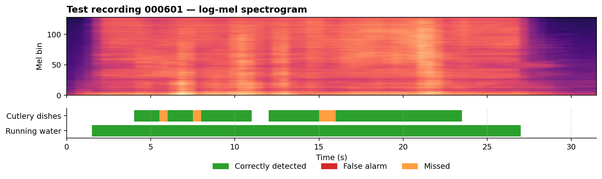
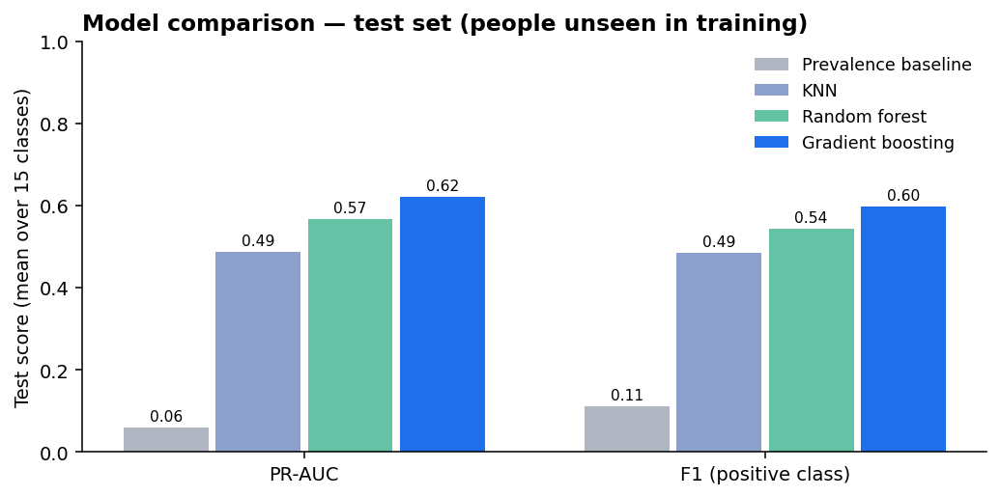
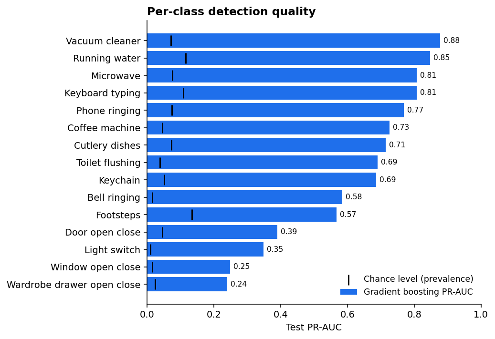
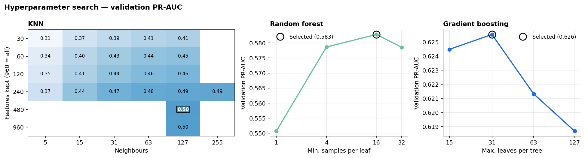

# 🔊 Sound Event Detection

**Detecting 15 household sounds — running water, a vacuum cleaner, a phone ringing, footsteps — second by second in real-world recordings, evaluated on people the model has never heard. The final gradient-boosting model reaches a test PR-AUC of 0.62 against a chance level of 0.06.**

[](https://github.com/dimitar-sudo/sound_event_detection_system/actions/workflows/tests.yml)
[](https://www.python.org/)
[](https://scikit-learn.org/)
[](LICENSE)



<sub>A test recording by a person not seen during training: the spectrogram above, the model's frame-by-frame detections below. This file was picked automatically as the best-detected test recording with at least two annotated sound types (`pick_demo_file` in `sed/visualization/figures.py`), so it shows the model at its best. Typical performance is in [Results](#results).</sub>

## Overview

The task is **multi-label, frame-level detection**. Each recording is cut into 1-second frames (0.5 s hop), and for every frame the model decides, for each of 15 sound classes, whether that sound is present. Several sounds can be active at once.

| | |
|---|---|
| **Data** | MLPC2026 development set: 3,656 recordings from 408 people, 168,239 frames, 960 pre-extracted audio features per frame (mel-spectrogram, MFCCs + deltas, spectral statistics) |
| **Labels** | Several annotators per recording; a frame is positive when the majority agree |
| **Challenge** | Rare events: each class is present in only 1%–13% of frames |
| **Protocol** | Split **by person** (70 / 15 / 15), so no one's recordings, rooms or devices appear in both training and test |
| **Final model** | One gradient-boosted tree ensemble per class, with per-class decision thresholds |

## Results

Test-set scores, averaged over the 15 classes. Each model's hyperparameters and thresholds were chosen on the validation people only; the test people were used once, for this table.

| Model | PR-AUC | F1 | Precision | Recall |
|---|:---:|:---:|:---:|:---:|
| Prevalence baseline | 0.060 | 0.111 | 0.060 | 1.000 |
| KNN | 0.487 | 0.486 | 0.482 | 0.510 |
| Random forest | 0.567 | 0.543 | 0.556 | 0.562 |
| **Gradient boosting** | **0.620** | 0.598 | 0.614 | 0.604 |

<p align="center"></p>

**Per class.** Sounds that are long and steady (vacuum cleaner, running water, microwave, keyboard) are detected reliably. Short, sharp sounds (a light switch, a door, a drawer or window opening and closing) are much harder, most likely because they fill only a fraction of a 1-second frame and are easily masked by background noise. Every class scores at least 4× its chance level.

<p align="center"></p>

<div align="center">

**Gradient boosting — per-class test metrics**

| Class | Prevalence | PR-AUC | F1 | Precision | Recall | Threshold |
|---|:---:|:---:|:---:|:---:|:---:|:---:|
| Vacuum cleaner | 7.1% | 0.877 | 0.799 | 0.793 | 0.805 | 0.079 |
| Running water | 11.5% | 0.848 | 0.763 | 0.726 | 0.804 | 0.146 |
| Microwave | 7.5% | 0.807 | 0.754 | 0.779 | 0.730 | 0.241 |
| Keyboard typing | 10.8% | 0.807 | 0.746 | 0.817 | 0.687 | 0.234 |
| Phone ringing | 7.4% | 0.769 | 0.732 | 0.779 | 0.690 | 0.204 |
| Coffee machine | 4.5% | 0.726 | 0.661 | 0.850 | 0.540 | 0.243 |
| Cutlery dishes | 7.3% | 0.714 | 0.666 | 0.679 | 0.652 | 0.192 |
| Toilet flushing | 3.8% | 0.690 | 0.644 | 0.799 | 0.539 | 0.317 |
| Keychain | 5.1% | 0.685 | 0.646 | 0.600 | 0.700 | 0.144 |
| Bell ringing | 1.6% | 0.584 | 0.556 | 0.604 | 0.516 | 0.023 |
| Footsteps | 13.5% | 0.568 | 0.539 | 0.502 | 0.581 | 0.150 |
| Door open close | 4.5% | 0.390 | 0.432 | 0.378 | 0.504 | 0.125 |
| Light switch | 1.0% | 0.348 | 0.429 | 0.359 | 0.532 | 0.012 |
| Window open close | 1.6% | 0.249 | 0.303 | 0.221 | 0.483 | 0.030 |
| Wardrobe drawer open close | 2.5% | 0.240 | 0.304 | 0.320 | 0.289 | 0.128 |

</div>

## How the project evolved

1. **Baseline.** Scoring every frame with the class's training prevalence gives the "no skill" reference: PR-AUC equals prevalence (0.06 on average).
2. **KNN.** My first model: variance filter → standardisation → the top-*k* features per class by mutual information → distance-weighted KNN. It beats the baseline clearly (test PR-AUC 0.49). The sweep was instructive: many neighbours (127) worked far better than few, likely because averaging over more neighbours gives smoother probability scores to rank by. Aggressive feature selection hurt; keeping 480 of 960 features scored the same as keeping all of them.
3. **Random forest.** Trees work directly on the raw features, with no scaling or feature selection, and clearly outperform KNN (test PR-AUC 0.57).
4. **Gradient boosting.** Histogram-based gradient boosting gave the best validation PR-AUC. It trained in less than half the random forest's time (16 vs 37 minutes per configuration on average) and produces a 27 MB model, so it is the one shipped (test PR-AUC 0.62).

**Fixing the evaluation along the way.** My earlier experiments had three problems that made their scores unreliable, and the current protocol fixes each:

| Earlier version | Problem | Now |
|---|---|---|
| Split by recording | The same person's recordings (same room and device) were in both train and test | Split **by person** |
| "Macro F1" averaged over present *and* absent | With events in at most 13% of frames, the "absent" half dominates and inflates the score | **PR-AUC** and **F1 of the positive class** |
| Validation and test used different decision thresholds | Test scores did not reflect the tuned model | Per-class thresholds chosen on validation and reused unchanged on test |

## Method

- **Model selection.** Every model's grid is trained on the training people and ranked by mean validation PR-AUC, which does not depend on a threshold. When the best setting landed on the edge of a grid, the grid was extended until the optimum was inside it.
- **Thresholds.** For each class, the probability threshold that maximises validation F1 is stored and applied as-is to test and in `predict`. Thresholds are plain probabilities, so a rare class can (and does) get a threshold far below 0.5.
- **Metrics.** PR-AUC is the headline metric because it measures ranking quality on rare positives; a random model scores the class prevalence. F1, precision and recall describe the detector at its chosen operating point.



<sub>Blank KNN cells were not tried: the grid was extended only in the direction the optimum was moving.</sub>

All numbers in this README are generated from [`results/`](results/): `summary.csv` (model comparison), `test_metrics_*.csv` (per class), `selected_configs.json` (chosen hyperparameters and thresholds) and `sweeps/*.csv` (every configuration tried).

## Skills demonstrated

- **Machine learning:** multi-label classification under heavy class imbalance; KNN, random forests and gradient boosting compared under one protocol; mutual-information feature selection; per-class threshold tuning.
- **Rigorous evaluation:** leakage-free grouped splitting, metrics chosen for rare events, validation-only model selection and a single use of the test set. I found and corrected flaws in my own earlier evaluation.
- **Audio / signal processing:** working with frame-level spectral features (mel-spectrogram, MFCCs, spectral flux, contrast) and multi-annotator labels.
- **Software engineering:** a modular Python package with a CLI, resumable experiment sweeps, cached intermediate results, pytest unit tests, GitHub Actions CI and pinned dependencies.
- **Communication:** reproducible figures and a README generated from saved results.

## Quickstart

Requires **Python 3.12**.

```bash
git clone https://github.com/dimitar-sudo/sound_event_detection_system.git
cd sound_event_detection_system
python -m venv .venv && source .venv/bin/activate      # Windows: .venv\Scripts\activate
pip install -r requirements.txt
```

**Try the trained model.** No dataset needed; an example recording's features are included:

```bash
python -m sed predict examples/000601.npz --plot timeline.png
```

```
000601.npz: 62 frames, 6 detected events
         event  onset_s  offset_s
 running_water      1.5      27.5
cutlery_dishes      4.0       6.0
cutlery_dishes      6.0       8.0
cutlery_dishes      8.0      11.5
cutlery_dishes     12.0      15.5
cutlery_dishes     16.0      24.0
```

The cutlery sound is split into several events. The pause at 11–12 s is real, but the other gaps are one or two missed frames, which smoothing predictions over time would close (see [Limitations](#limitations--next-steps)). The model raises no false alarms anywhere in this file.

**Reproduce everything.** Place the `MLPC2026_dataset_development/` folder (with `audio_features/` and `metadata.csv`) in the project root, then:

```bash
python -m sed prepare                 # cache all frames, print split statistics
python -m sed sweep baseline          # each sweep is resumable
python -m sed sweep knn
python -m sed sweep random_forest
python -m sed sweep boosting
python -m sed evaluate                # select on validation, score on test → results/
python -m sed export                  # save the selected boosting model → models/
python -m sed figures                 # regenerate docs/figures/
pytest -q
```

On a laptop CPU (Intel i7-13620H), the full set of sweeps took about 5 hours, most of it the random forest.

## Project structure

```
├── sed/
│   ├── __main__.py            # CLI: prepare, sweep, evaluate, export, figures, predict
│   ├── config.py              # classes, feature groups, paths, split settings
│   ├── data/                  # .npz loading, majority-vote labels, frame cache, split by person
│   ├── models/                # per-class detector wrapper, KNN feature selection, model grids
│   ├── evaluation.py          # PR-AUC / F1 metrics and threshold selection
│   ├── experiment.py          # sweeps, model selection, test evaluation, export
│   ├── inference.py           # run the shipped model on a file, merge frames into events
│   └── visualization/         # README figures
├── models/detector.joblib     # shipped model + per-class thresholds
├── examples/                  # example feature file for the quickstart
├── results/                   # all metrics behind this README
├── docs/figures/
└── tests/
```

## Limitations & next steps

- **No temporal context.** Each frame is classified independently. Smoothing predictions over time (e.g. a median filter), or a sequence model such as a CRNN, would likely help most for the short, impulsive classes.
- **Frame-level metrics only.** Event-based metrics (onset/offset tolerance, as in the DCASE challenges) would better reflect how a detector is used in practice.
- **Pre-extracted features.** Learning from raw spectrograms with a CNN, or from pretrained audio embeddings (e.g. PANNs, BEATs), is the natural next step.
- **Single split and seed.** Repeating with cross-validation by person would give confidence intervals.

## Author

**Dimitar Karaskakovski** · [LinkedIn](https://www.linkedin.com/in/dimitar-karaskakovski-85166436b) · [GitHub](https://github.com/dimitar-sudo)

Code released under the [MIT License](LICENSE). The MLPC2026 dataset (recordings, features and annotations) is distributed under CC0; the example file in `examples/` comes from it.
